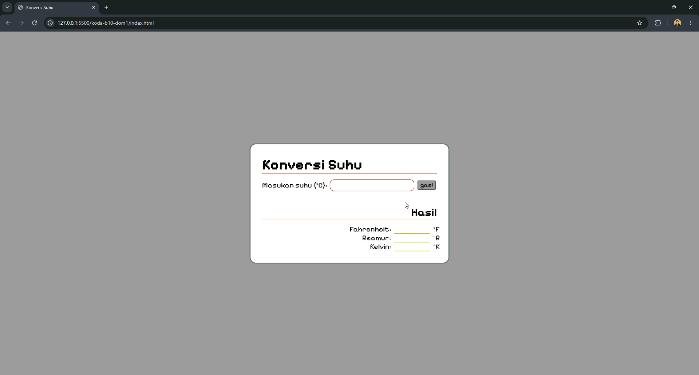

# Materi: DOM (Document Object Model)

Membuat program konversi suhu dengan memanfaatkan DOM manipulation, terbatas pada penggunaan selector dan node object.

**Preview Hasil**

[Link to Code](index.html)